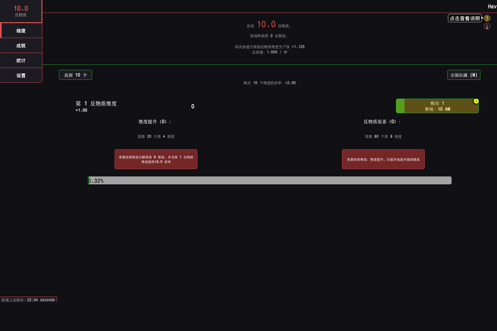
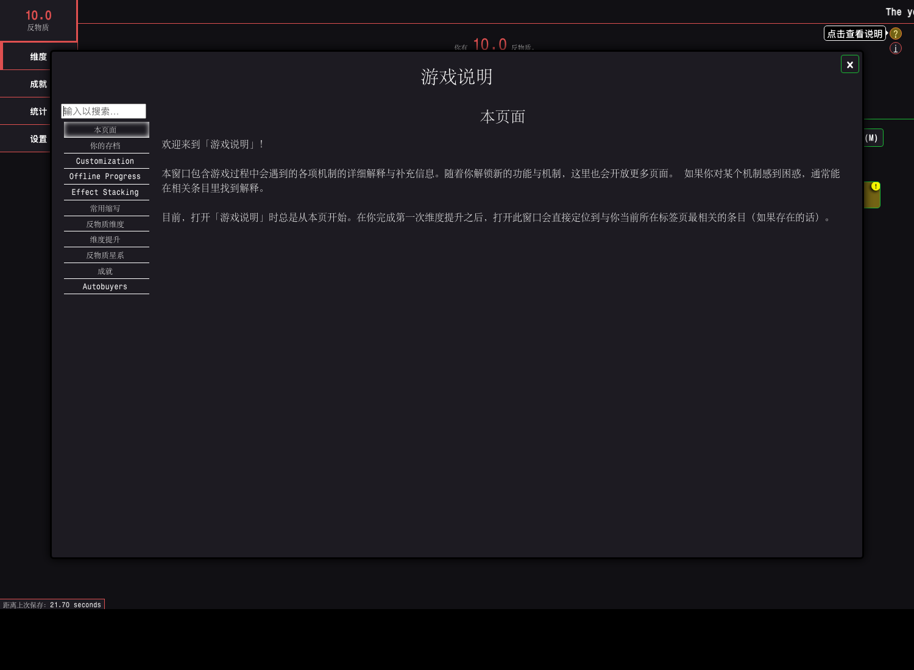

# 反物质维度（Antimatter Dimensions）源码解析与开发指南

> 适用版本：本仓库快照 `master` 分支，commit `5409e32`（提交信息 *Update changelog.js*，2026-07-17）。
> 游戏版本 `11.5`（`public/version.txt`），存档版本 `25`（`src/core/player.js` 中 `player.version`）。
>
> **一句话总结**：这是一个 Vue 2 + Vue CLI 5（webpack 5）的**纯 JavaScript** 单页应用，没有 TypeScript、没有单元测试；
> 游戏逻辑在 `src/core`，界面在 `src/components`，**所有平衡数值和文案**在 `src/core/secret-formula`。
> 代码风格高度"数据驱动"：配置和实现分离，全局单例 + 事件总线 + 每帧轮询刷新 UI。

---

## 0. 30 秒上手（本文命令均已在本机实测通过）

```bash
cd /Users/starside/Documents/AntimatterDimensionsSourceCode

npm ci          # 安装依赖（首次约 40 秒，1392 个包）
npm run serve   # 启动开发服务器
# 浏览器打开 http://localhost:8080
```

实测结果：

| 命令 | 结果 |
| --- | --- |
| `npm ci` | ✅ 成功（Node v26.11.0 / npm 11.20.0） |
| `npm run serve` | ✅ 9 秒编译完成，`http://localhost:8080` 正常出画面（10 反物质、8 个维度、标签页与存档计时都在跑） |
| `npx vue-cli-service build` | ✅ 生产构建成功，产出 `dist/`（约 49 MB，含 sourcemap） |
| `npx eslint src/core/constants.js` | ✅ 通过 |

> ⚠️ 官方 CI（`.github/workflows/deploy-master.yml`）使用的是 **Node 14**。
> 本机 Node 26 实测可跑；但你若想复现官方环境或遇到奇怪的构建问题，建议切到 **Node 18 / 20 LTS**
> （nvm / fnm / volta 均可）。Node 22/24 大概率也能跑，但本文只验证了 26。

---

## 1. 这是个什么项目

《Antimatter Dimensions》是一款"增量/放置"（incremental / idle）游戏：数字不断变大，通过一次次"重置"换取永久加成。
主线进程为：

```
反物质(AM) → 维度提升/星系 → Big Crunch(无限) → Eternity(永恒) → Reality(现实)
            → 天界(Celestials: Teresa/Effarig/Enslaved/V/Ra/Laitila/Pelle) → 游戏终局
```

代码规模（本快照）：

| 项 | 数量 |
| --- | --- |
| `src/core` JS 文件 | 238 |
| `src/components` Vue 单文件组件 | 409 |
| `src/components` JS 文件 | 12 |
| 顶层 Tab | 11 |
| 子 Tab（subtab） | 42 |
| 存档版本 | 25 |

---

## 2. 技术栈

| 层 | 选型 | 说明 |
| --- | --- | --- |
| 框架 | **Vue 2.6**（Options API） | 全局只有一个 Vue 根实例 `ui`，挂载在 `#ui` |
| 构建 | **Vue CLI 5.0.0-rc.0 + webpack 5** | `vue.config.js` 只有寥寥几行 |
| 语言 | **JavaScript (ES2021)** + JSDoc | 没有 TypeScript；`jsconfig.json` 只用于编辑器跳转 |
| 数值 | **break_infinity.js v2** | `Decimal`，支持到 `1e9e15` 级别；在 `src/core/extensions.js` 里被大量扩展 |
| 数值格式化 | `@antimatter-dimensions/notations` | 科学计数法、工程计数法、盲文、Emoji 等几十种记数法 |
| 压缩 | `pako`(zlib) + 自研 base64 | 存档序列化 `src/core/storage/serializer.js` |
| 编辑器 | `codemirror` 5 | Automator 脚本编辑器 |
| 图谱 | `vis-network` 5 | 时间研究树、天界导航图 |
| 动画 | `tween.js`、CSS animation、`webm` 视频 | |
| 账号/云存档 | `firebase` 9（可选） | 没有配置时自动禁用，本地开发不受影响 |
| 桌面/商店 | Greenworks + PlayFab（Steam 版） | `src/steam`，仅 `VUE_APP_STEAM=true` 时生效 |
| 代码检查 | ESLint 7 + Stylelint 14 | 146 条 ESLint 规则 |
| 测试 | **无** | 没有 jest / vitest / cypress |

---

## 3. 目录结构

```
.
├── src/
│   ├── main.js               # 入口：shims → merge-globals → init()
│   ├── game.js               # ★ 游戏主循环 gameLoop()、离线模拟 simulateTime()、init()
│   ├── env.js                # DEV / STEAM / MAC 环境常量
│   ├── merge-globals.js      # ★ 把各模块导出挂到 window 上（全局命名空间）
│   ├── commit-watcher.js     # 线上检查新提交（本地环境自动跳过）
│   ├── supported-browsers.js # 由 build/pre-build.js 生成的 UA 正则
│   ├── shims.js / polyfill.js
│   │
│   ├── core/                 # ★ 游戏逻辑（不依赖 Vue）
│   │   ├── player.js         # 玩家状态单例（存档结构的事实来源）
│   │   ├── new-game.js       # 新游戏初始化
│   │   ├── globals.js        # 汇总导出所有 core 模块 → window.*
│   │   ├── constants.js      # DC（常量 Decimal 表）
│   │   ├── math.js           # 数学工具：批量购买二分、对数插值等
│   │   ├── extensions.js     # 扩展 Array/Math/Decimal 原型
│   │   ├── cache.js          # Lazy 缓存 + GameCache
│   │   ├── event-hub.js      # ★ 事件总线 + GAME_EVENT 枚举
│   │   ├── intervals.js      # ★ 所有 setInterval（gameLoop 33ms、自动保存等）
│   │   ├── ui.js             # GameUI：Vue 全局 mixin、$recompute、update 分发
│   │   ├── ui.init.js        # ui.view 的初始状态（纯 UI 临时状态）
│   │   ├── tabs.js           # Tab / Subtab 状态机
│   │   ├── modal.js          # 弹窗注册表
│   │   ├── devtools.js       # ★ window.dev.* 调试命令
│   │   ├── format.js         # 数字/时间格式化
│   │   ├── timespan.js, time.js
│   │   ├── dimensions/       # 反物质/无限/时间维度
│   │   ├── glyphs/           # 符文
│   │   ├── time-studies/     # 时间研究树
│   │   ├── celestials/       # 天界（teresa/effarig/enslaved/V/ra/laitela/pelle）
│   │   ├── automator/        # 自动机：lexer/parser/compiler（chevrotain）
│   │   ├── autobuyers/       # 自动购买器
│   │   ├── achievements/     # 成就
│   │   ├── game-mechanics/   # ★ 机制基类：Effect / GameMechanicState / BitUpgrade / Purchasable
│   │   ├── storage/          # ★ 存档：storage.js / serializer.js / migrations.js / dev-migrations.js
│   │   └── secret-formula/   # ★★ 所有数值与文案配置（GameDatabase）
│   │
│   ├── components/           # Vue 组件（UI）
│   │   ├── GameUIComponent.vue        # 根组件：三套 UI 外壳 + 当前 tab
│   │   ├── GameUiComponentFixed.vue   # 固定层：弹窗、侧边栏、保存计时、通知
│   │   ├── ui-modes/{classic,modern,s12}/
│   │   ├── tabs/                      # 每个 tab 一个目录
│   │   ├── modals/                    # 弹窗
│   │   └── *.vue                      # 通用小组件（按钮、成本显示、符文…）
│   │
│   ├── steam/                # Steam/Electron/PlayFab 绑定
│   ├── utility/              # deepmerge、类型检查、外链
│   └── typings/              # 第三方库的 .d.ts（仅供参考，不参与编译）
│
├── public/                   # 不经过 webpack 的静态资源（index.html、CSS、图片、音频、字体）
│   └── stylesheets/          # 老式全局 CSS（styles.css、new-ui-styles.css、主题 theme-*.css）
├── build/                    # 构建脚本：check-npm / pre-build / post-build
├── vue.config.js
├── package.json
└── .eslintrc.json / .stylelintrc.json / .editorconfig / .browserslistrc
```

> 注意：没有 `tests/` 目录，`package.json` 里也没有 `test` 脚本。质量保障靠 ESLint + 手动测试。

---

## 4. 启动流程：从 `index.html` 到游戏循环

### 4.1 加载阶段

```
public/index.html
  └─ <div id="ui"> + #loading 遮罩
       ↓ (webpack 注入 js/app.js)
src/main.js
  ├─ import "drag-drop-touch"      # 触屏拖拽兼容
  ├─ import "./shims"              # 全局 polyfill
  ├─ import "./merge-globals"      # ★ 把 core/* 的导出全部挂到 window
  ├─ browserCheck() ? init()       # UA 正则判断浏览器是否受支持
  └─ DEV ? watchLatestCommit()     # 本地环境自动跳过
       ↓
game.js → init()
  ├─ ElectronRuntime.initialize()  # 非 Electron 环境直接 return
  ├─ SteamRuntime.initialize()     # 非 Steam 环境直接 return
  ├─ Cloud.init()                  # 无 firebase 配置则禁用
  ├─ GameStorage.load()            # ★ 读 localStorage → 反序列化 → 迁移 → deepmerge
  ├─ Tabs.all.find(lastOpenTab).show(true)
  └─ Payments.init()
       ↓
window.onload → 隐藏 #loading，GameUI.initialized = true
```

`merge-globals.js` 是理解本项目的**第一个关键点**：它把 `core/utils`、`core/secret-formula`、`core/globals`、`game.js`
的**所有具名导出**逐个挂到 `window` 上，并且**遇到同名直接抛异常**：

```js
// src/merge-globals.js（节选）
function mergeIntoGlobal(object) {
  for (const key in object) {
    if (key === "default") continue;          // 跳过 default export
    const value = object[key];
    if (window[key] !== undefined) throw `Property ${key} already exists in global context`;
    window[key] = value;
  }
}
mergeIntoGlobal(Utils);          // core/utils
mergeIntoGlobal(GameDB);         // core/secret-formula
mergeIntoGlobal(core);           // core/globals
mergeIntoGlobal(game);           // game.js
```

所以你会看到全代码里**到处直接用 `player`、`Achievement(11)`、`Currency.antimatter`、`format()`**，而不 import。
这是刻意的设计（历史包袱 + 减少样板），但也是本项目最大的"隐式依赖"来源。

### 4.2 主循环

`GameIntervals` 在 `intervals.js` 里创建了一组 interval，但**初始化时不启动**，
真正的启动点在存档加载完成后（`GameStorage.postLoadStuff()` 里的 `GameIntervals.restart()`）。

```js
// src/core/intervals.js
gameLoop: interval(() => gameLoop(), () => player.options.updateRate), // 默认 33ms ≈ 30 FPS
save:     interval(() => GameStorage.save(), ...),                     // 默认 30s 自动保存
```

`gameLoop(passDiff)` 的顺序（`src/game.js`，简化版）：

```
1.  EventHub.dispatch(GAME_TICK_BEFORE)
2.  终局/速通暂停 → 提前 return
3.  休眠检测：单帧 > 60s（设备休眠）→ 停表 + simulateTime() 模拟，而不是让游戏"跳一下"
4.  realTimeMechanics(realDiff)      # 只依赖真实时间的机制（如 Enslaved 存时间）
5.  Autobuyers.tick() / Tutorial / 符文权重自动调整
6.  失效 GameCache 里所有维度倍率缓存
7.  计算游戏速度倍率（时间符文 / 黑洞 / 奇点 / EC12 固定速度）
8.  累加各类时间记录；DeltaTimeState.update()
9.  挑战、被动产出、自动声望、幻想机器、炼金"不可计数"
10. TimeDimensions.tick → InfinityDimensions.tick → AntimatterDimensions.tick   # ★ 产出
11. 声望速率统计、IC 自动完成、Replicanti、膨胀、超光速星系、TT、黑洞相位
12. 自动解锁、符文选择、天界/Pelle/银河生成器/Automator 更新
13. EventHub.dispatch(GAME_TICK_AFTER)
14. GameUI.update()        # ★ 触发 Vue 重绘
15. player.lastUpdate = now
```

### 4.3 UI 刷新模型（重要）

游戏**没有**用 Vuex，也**没有**把 `player` 变成响应式（那会慢到爆炸）。
刷新方式是"**每帧手动通知**"：

```js
GameUI.update()
  → EventHub.ui.dispatch(GAME_EVENT.UPDATE)
      → 每个注册了 update() 的组件执行 update()
```

组件侧只需要写一个 `update()` 方法，剩下的由全局 mixin 自动完成：

```js
// src/core/ui.js
Vue.mixin({
  computed: {
    $viewModel() { return state.view; }   // 只读的 UI 临时状态
  },
  created() {
    if (this.update) {
      this.on$(GAME_EVENT.UPDATE, this.update);         // 自动注册
      if (GameUI.initialized) this.update();            // 首次渲染
    }
    // ...为每个 computed 建立"可重算"开关
  },
  methods: { on$(event, fn) { EventHub.ui.on(event, fn, this); }, ... }
});
```

于是每个组件的典型写法是：

```vue
<script>
export default {
  data() { return { amount: new Decimal(0) }; },  // 只放"界面快照"，绝不放 player 引用
  methods: {
    update() {                                     // 每帧被调用，只做廉价读取
      this.amount = Currency.antimatter.value;
    }
  }
};
</script>
<template><div>{{ format(amount) }}</div></template>
```

两条铁律：

1. **不要把 `player` 或任何 `Decimal` 大对象塞进 `data()`**。`DEV` 模式下有 `ReactivityComplainer` 会直接抛错：
   `"Boi you fukked up - player.xxx became REACTIVE"`。
2. `update()` 每帧都跑（30 次/秒 × 几百个组件），里面**不要做重计算**；重计算放 `GameCache`（见 §5.5）。

另外 `$recompute(key)` 是一个 hack：把某个 `computed` 的 getter 包一层可变标记，用来强制重算
（因为很多计算依赖的是非响应式的全局对象，Vue 感知不到变化）。

---

## 5. 七个核心抽象（看懂这些等于读懂 80%）

### 5.1 `player`：唯一持久化状态

`src/core/player.js` 导出 `window.player` 字面量，**它就是存档结构**：

```js
window.player = {
  antimatter: DC.E1,
  dimensions: { antimatter: [...8 个], infinity: [...], time: [...] },
  infinityPoints: DC.D0,
  eternities: DC.D0,
  realities: 0,
  records: { ... },
  celestials: { ... },
  options: { updateRate: 33, autosaveInterval: 30000, ... },
  version: 25,
  ...
};
export const Player = { defaultStart: deepmergeAll([{}, player]), ... };
```

- `Player.defaultStart` 是启动时的**深拷贝快照**，读档时用作"补全缺失字段"的模板。
- 读档时 `player = deepmergeAll([{}, Player.defaultStart])` 会**整体替换 window.player**，
  所以任何模块都不能缓存 `player` 的引用（只能每次访问 `player.xxx`）。
- `guardFromNaNValues()`（`player.js` 末尾）会递归扫描 NaN/Infinity；它在 `DEV` 下读档时被调用，
  用来尽早发现"某个机制算出了 NaN"。

### 5.2 `GameDatabase` / `secret-formula`：配置与逻辑分离

`src/core/secret-formula/` 里**只有数据**，没有逻辑：

```js
// src/core/secret-formula/reality/reality-upgrades.js（数组，按 id 索引）
export const realityUpgrades = [
  ...
  {
    name: "Existentially Prolong",
    id: 10,
    cost: 15,
    requirement: () => `Complete your first manual Eternity with at least ... IP`,
    checkRequirement: () => Currency.infinityPoints.exponent >= 400 && ...,
    checkEvent: GAME_EVENT.ETERNITY_RESET_BEFORE,
    description: () => `Start every Reality with ${formatInt(100)} Eternities ...`,
    effect: () => 1,
  },
  // ...
];
```

`game-database.js` 把所有这些聚合成一个对象，并挂到 `window.GameDatabase`：

```js
export const GameDatabase = {
  achievements, awayProgressTypes, catchupResources, celestials, challenges,
  changelog, confirmationTypes, credits, discordRichPresence, eternity, h2p,
  infinity, multiplierTabTree, multiplierTabValues, news, progressStages,
  reality, sidebarResources, shopPurchases, speedrunMilestones,
  tabNotifications, tabs,
};
window.GameDatabase = GameDatabase;
```

**改数值 = 只改这个目录**；除非要改行为，否则不用碰 `core` 里的逻辑文件。

### 5.3 `GameMechanicState` + `createAccessor`：把配置变成对象

几乎所有"可购买/可解锁/有效果"的东西（成就、升级、符文效果、里程碑、天界升级……）都遵循同一模式：

```js
// 1) 定义类，继承基类
class RealityUpgradeState extends BitPurchasableMechanicState {
  get bits() { return player.reality.upgradeBits; }
  get currency() { return Currency.realityMachines; }
  ...
}

// 2) 用配置数组生成"按 id 索引"的访问器
export const RealityUpgrade = RealityUpgradeState.createAccessor(GameDatabase.reality.upgrades);

// 3) 全代码直接用
RealityUpgrade(10).isBought
RealityUpgrade(10).effectValue
```

`createAccessor` 内部就是 `mapGameData(configs, c => new this(c))`，返回一个带 `.index` 的函数。
你会看到 `Achievement(11)`、`TimeStudy(111)`、`EternityMilestone.keepBreakUpgrades`、`BlackHole(1)` 等几十个这样的访问器。

基类层级（`src/core/game-mechanics/`）：

```
Effect                        # 效果值 + cap + condition
└─ GameMechanicState          # + config、事件注册、createAccessor
   ├─ BitUpgradeState         # 用位掩码存储"是否解锁"（player.xxxBits）
   │  └─ BitPurchasableMechanicState   # + 货币购买
   ├─ PurchasableMechanicState
   └─ RebuyableMechanicState  # 可重复购买的 1/2/3 号升级
```

> 位掩码是这套代码的常见存储法：成就用 `player.achievementBits`（每 10 个 id 占一个 32 位整数的一行，
> 当前成就 id 最大到 188）；`player.reality.upgradeBits` 一个整数就能存 32 个升级。

### 5.4 `Effect` 与 `Decimal` 扩展：链式倍率

`Decimal` 被扩展了一堆"吃效果对象"的方法（`src/core/extensions.js` + `src/core/game-mechanics/effect.js`）：

```js
multiplier = multiplier.timesEffectOf(Achievement(56));
multiplier = multiplier.timesEffectsOf(TimeStudy(91), InfinityChallenge(3), PelleUpgrade.x);
multiplier = multiplier.dividedByEffectOf(InfinityChallenge(6));
multiplier = multiplier.powEffectOf(AlchemyResource.force);
```

这些方法会自动处理：`effectValue` 的 cap、`isEffectActive` 条件、`1` 的默认值。
**不要手动写 `if (x.isBought) multiplier = multiplier.times(x.effectValue)`**，用这些方法，代码才和上游风格一致。

### 5.5 `Lazy` / `GameCache`：缓存

```js
// src/core/cache.js
export const GameCache = {
  tickSpeedMultDecrease: new Lazy(() => 10 - Effects.sum(...)),
  totalIPMult: new Lazy(() => ...).invalidateOn(GAME_EVENT.BIG_CRUNCH_AFTER),
};

GameCache.totalIPMult.value      // 第一次算，之后取缓存
GameCache.totalIPMult.invalidate();
Lazy.invalidateAll();            // 全局失效（切换存档等场景）
```

`gameLoop` 每帧都会 invalidate 维度相关的倍率缓存，所以改倍率**不需要**你手动清缓存；
但如果你新增了一个"很少变、算起来很贵"的值，就应该放进 `GameCache`。

### 5.6 `EventHub` / `GAME_EVENT`：事件总线

```js
// 逻辑层订阅
EventHub.logic.on(GAME_EVENT.BIG_CRUNCH_AFTER, () => { ... }, this);
// 派发（同时通知逻辑层和 UI 层）
EventHub.dispatch(GAME_EVENT.BIG_CRUNCH_AFTER);
```

`GAME_EVENT` 枚举在 `event-hub.js` 里，包含两类：

- **游戏事件**：`GAME_TICK_BEFORE/AFTER`、`BIG_CRUNCH_*`、`ETERNITY_RESET_*`、`REALITY_RESET_*`、`GLYPHS_CHANGED`、
  `ACHIEVEMENT_UNLOCKED`、`SAVE_CONVERTED_FROM_PREVIOUS_VERSION`…
- **UI 事件**：`UPDATE`、`TAB_CHANGED`、`CLOSE_MODAL`

派发是**同步**的，`EventHub.dispatch` 会先给 `logic` 再给 `ui`。
`EventHub.stats` 可以在控制台看当前有多少监听器（性能排查用）。

### 5.7 `player` vs `ui.view`：持久化状态 vs 界面状态

| | 存哪 | 会存档吗 | 例子 |
| --- | --- | --- | --- |
| 游戏状态 | `player.*` | ✅ 会 | 反物质、升级、选项 |
| 界面状态 | `ui.view.*`（`ui.init.js`） | ❌ 不会 | 当前 tab、shift 是否按下、弹窗队列、符文 tooltip |

组件里通过 `this.$viewModel.xxx` 读写界面状态。注意 `player.options` 里也有 `lastOpenTab` 这类"跨会话记住"的 UI 偏好——
那种就要放 `player`。

---

## 6. 数值与存档

### 6.1 Decimal 与 `DC`

- 所有大数都是 `break_infinity.js` 的 `Decimal`，**不要用原生 `number`**（除了计数器、时间戳、索引）。
- `src/core/constants.js` 的 `DC` 是冻结的常用常量表：`DC.D0`、`DC.D1`、`DC.E100`、`DC.E308`…
- `format(x)` / `formatInt(x)` / `formatX(x)` / `formatPercents(x)` 是统一格式化入口（`src/core/format.js`）。

### 6.2 存档格式

```
localStorage["dimensionSave"]  (生产)  /  localStorage["dimensionTestSave"]  (DEV)
  └─ "AntimatterDimensionsSavefileFormat" + "AAB" + 变体base64( zlib( UTF-8( JSON ) ) ) + "EndOfSavefile"
       JSON = { current: 0, saves: { 0: player, 1: player, 2: player } }
```

- 序列化器：`src/core/storage/serializer.js`，编码步骤依次是
  `UTF-8 → pako.deflate → 逐字节转字符 → btoa → 替换 + / = 为 0a/0b/0c → 拼前后缀`。
- 前后有 magic string：`AntimatterDimensionsSavefileFormat` … `EndOfSavefile`
- 版本号 `AAB`（三段式，用于兼容性判断；导入时不在白名单就走老式 `atob` 解析）
- `Set` 会被转成数组，`Infinity` 会被转成字符串 `"Infinity"`
- 3 个手动存档槽 + 8 个自动备份槽（1min/5min/20min/1h/10min/1h/5h/预留）
- 云存档（Firebase）在没有 `FIREBASE_CONFIG` 时 `Cloud.isAvailable === false`，功能整个禁用

> **DEV 模式的存档键是分开的**（`dimensionTestSave`），所以本地调试不会污染你在正式版的存档。

### 6.3 存档迁移（改 `player` 结构时必读）

`src/core/storage/migrations.js`：

```js
export const migrations = {
  firstRealityMigration: 13,
  patches: {
    1:  player => { ... },
    2:  player => { ... },
    10: player => { ... },
    ...
  },
  patchPreReality(p) { return this.patch(p, this.firstRealityMigration); },
  patchPostReality(p) { return this.patch(p); },
};
```

读档流程（`storage.js → loadPlayerObject`）：

```
checkPlayerObject() 校验（坏档 → 用 defaultStart 重开）
  → migrations.patchPreReality()      # 应用编号 < 13 的补丁（Reality 之前的老档）
  → if (DEV) devMigrations.patch()    # 仅开发环境的临时迁移
  → migrations.patchPostReality()     # 应用其余补丁，逐条把 player.version 往上推
  → deepmergeAll([{}, Player.defaultStart, player])  # ★ 用默认值补全新字段
  → 离线进度模拟
```

**加字段的正确姿势**：

1. 在 `player.js` 里加默认值。老存档缺这个字段时，`deepmergeAll` 会自动补上 → **大多数情况下你不需要写迁移**。
2. 只有"字段含义变了 / 需要换算 / 要发补偿"时，才需要：
   - 把 `player.version` 从 `25` 改成 `26`
   - 在 `migrations.patches[26]` 里写迁移函数
3. **开发期的临时结构改动**放 `dev-migrations.js`（`testVersion` 机制），它只在 `DEV` 下执行，不会污染线上逻辑。

### 6.4 反作弊/健康检查

- `guardFromNaNValues(obj)`：递归检查 NaN / Infinity
- `checkPlayerObject()`：检查必填字段、字段类型
- 坏档处理：`DEV` 下控制台打印原因，然后重开新档

---

## 7. UI 层

### 7.1 三套"外壳"

`GameUIComponent.vue` 根据设置切三套布局：

| 外壳 | 触发 | 文件 |
| --- | --- | --- |
| `ClassicUi` | 默认（旧 UI） | `components/ui-modes/classic/` |
| `ModernUi` | `player.options.newUI === true` | `components/ui-modes/modern/` |
| `S12Ui` | 主题 `S12`（彩蛋主题） | `components/ui-modes/s12/` |

外加一个永远存在的 `GameUiComponentFixed.vue`：弹窗、通知、保存计时、侧边栏、新闻条、天界语录。

> 少数 tab 有 `Classic*Tab.vue` / `Modern*Tab.vue` 两个版本（如反物质维度、成就、选项），
> tab 根组件用 `<component :is="activeComponent" />` 切换。大部分 tab 是共用的。

### 7.2 Tab 是配置出来的

```js
// src/core/secret-formula/tabs.js
export const tabs = [
  {
    key: "dimensions", name: "Dimensions", id: 0, hidable: true, hideAt: 2.9,
    subtabs: [
      { key: "antimatter", name: "Antimatter Dimensions", symbol: "Ω",
        component: "AntimatterDimensionsTab", id: 0, hidable: true },
      { key: "infinity", ..., condition: () => PlayerProgress.realityUnlocked() || ... },
    ]
  },
  ...
];
```

- `component: "AntimatterDimensionsTab"` 是一个**字符串**，靠 `src/components/tabs/index.js` 里的
  `TabComponents` 映射到真正的组件，再由 `GameUIComponent.vue` 的 `components: {...TabComponents}` 解析。
- `condition` 未满足 = 子 tab 不显示；`hideAt` 控制终局时隐藏。
- `src/core/tabs.js` 把它们包装成 `TabState` / `SubtabState` 状态机（含"隐藏的 tab"、通知红点、上一个打开的 tab 记忆）。

### 7.3 组件写法约定

```vue
<script>
export default {
  name: "XxxTab",                 // 必须与 tabs.js 里的 component 字符串一致
  components: { ... },
  data() { return { /* 只放界面快照 */ }; },
  computed: { view() { return this.$viewModel; } },   // 惯例：暴露 view
  methods: {
    update() { /* 每帧调用，仅做廉价赋值 */ },
    handleClick() { /* 调 core 的函数，如 manualBigCrunchResetRequest() */ }
  }
};
</script>
```

- 事件：`@click="emitClick"`（mixin 提供 `emitClick/emitInput/emitClose`）
- tooltip：`v-tooltip` 指令（v-tooltip 2，class 统一 `general-tooltip`）
- **不要在组件里写游戏逻辑**：组件只调 `core` 暴露的函数 / 读 `core` 的值。

### 7.4 CSS

- 全局样式在 `public/stylesheets/`（`styles.css` 巨大，`new-ui-styles.css` 属于 Modern UI，`theme-*.css` 是主题）。
- 组件内 `<style scoped>` 也存在，但项目有个历史妥协文件 `public/stylesheets/vue-sfc-classes.css`
  （"Temporary inlined css classes from SFCs to prevent conflicts with old classes"）。
- 命名：kebab-case；前缀 `c-`（component）、`l-`（layout）、`o-`（object/通用）、`a-`（animation/keyframes）。
  Stylelint 会强制 `selector-class-pattern` 和 `keyframes-name-pattern`。

---

## 8. 启动 / 构建 / 发布

### 8.1 命令表

| 命令 | 用途 | 说明 |
| --- | --- | --- |
| `npm ci` | 安装依赖（严格按 lock 文件） | 首次或 `package-lock.json` 变更后 |
| `npm run serve` | 开发服务器 + HMR | 默认 <http://localhost:8080>，改端口 `npm run serve -- --port 3000` |
| `npm run build:master` | 构建"测试版"（部署到 gh-pages） | `--mode master` → `.env.master` → `VUE_APP_DEV=true` |
| `npm run build:release` | 构建"正式版" | 无 mode → `DEV=false`，输出 `dist/` |
| `npm run build:steam-development` | Steam 开发版 | 输出到 `../AppFiles` |
| `npm run build:steam-release` | Steam 正式版 | 输出到 `../AppFiles` |
| `npm run lint` | ESLint 全量检查 | 不会自动修；`vue-cli-service lint --fix` 才会 |

`npm run serve` 先跑 `node build/check-npm.js`：它比对 `package-lock.json` 的哈希（缓存在 `.tmp/package-lock.json.hash`），
不一致就**提示 5 秒后自动 `npm ci`**。想跳过就按一下回车。

### 8.2 构建脚本做了什么

| 文件 | 作用 |
| --- | --- |
| `build/check-npm.js` | lock 文件变了就重装依赖 |
| `build/pre-build.js` | ① 用 `.browserslistrc` 生成 `src/supported-browsers.js`（UA 正则）；② 若设了 `FIREBASE_CONFIG` 环境变量则写 `src/core/storage/firebase-config.js` |
| `build/post-build.js` | 把 `git rev-parse HEAD` / 最后一条提交信息写进 `dist/commit.json`（配合 `commit-watcher.js` 提示玩家刷新） |

产物的 `publicPath` 是 `"./"`（`vue.config.js`），资源都是相对路径，所以 `dist/` 可以放在任意子目录下部署，
甚至直接 `file://` 打开（官方仍走 HTTP，个别浏览器对 `file://` 的 `fetch` 有限制）。

### 8.3 实测记录（本机）

```
$ npm ci
added 1392 packages in 43s

$ npm run serve
 INFO  Starting development server...
 DONE  Compiled successfully in 9111ms
 App running at:
 - Local:   http://localhost:8080

$ npx vue-cli-service build
 DONE  Build complete. The dist directory is ready to be deployed.
 dist → 49M（含 .map 文件）
```

注意：`npm ci` 时 npm 11 会提示有 8 个包带 install script 未执行（core-js、fontawesome、vis-network 等）。
这些脚本只影响"捐赠提示打印 / git hooks"，**不影响运行**，可以忽略。

启动成功的样子（headless Chrome 实测截图）：



### 8.4 常见坑

| 现象 | 原因 / 解决 |
| --- | --- |
| `npm run serve` 卡在 "package-lock.json changes were detected" | 5 秒后自动 `npm ci`；按回车跳过 |
| 页面白屏、控制台 `Property XXX already exists in global context` | `merge-globals` 重名。改名，或不要在 `core` 里导出同名符号 |
| `player.xxx became REACTIVE` | 你把 `player` 放进了 `data()`/`computed`，改成只读快照 |
| 改了数值没生效 | 改的是 `src/core` 而非 `secret-formula`？或者命中了 `GameCache` 缓存 |
| 端口被占用 | `npm run serve -- --port 3001` |
| 浏览器提示 "Your browser is not supported" | `supported-browsers.js` 的 UA 正则；用 Chrome/Safari/Firefox 新版本 |
| 云存档报错 | 本地没有 `firebaseConfig`，属正常；`Cloud.isAvailable === false` |
| Node 版本太新导致奇怪报错 | 换 Node 18/20（官方 CI 用 14） |

---

## 9. 开发实战

### 9.1 先学会"调试"（Console 就是你的 REPL）

游戏**所有核心对象都挂在 window 上**，打开 DevTools Console 直接操作：

```js
// 读状态
player.antimatter = new Decimal("1e100");     // 改反物质
player.infinityPoints = new Decimal("1e10");
player.realities = 10;
GameUI.update();                              // 立刻刷新 UI

// 召唤官方调试命令（src/core/devtools.js）
dev.giveAllAchievements();
dev.giveGlyph(5000);          // 给一个 5000 级符文
dev.giveRealityGlyph(100);
dev.buyAllPerks();
dev.unlockAutomator();
dev.realize();                // 播放 Reality 动画
dev.togglePerformanceStats(); // 右上角性能面板
dev.hardReset();              // 清档重开（DEV 下清的是 dimensionTestSave）

// 时间控制
GameIntervals.stop();         // 暂停游戏循环（调试数值时很有用）
GameIntervals.start();
gameLoop(1000);               // 手动跑 1 秒游戏时间

// 存档
GameStorage.save();
GameStorage.load();           // 从 localStorage 重新读档（会重置 player 引用）
// 导出/导入用界面上的按钮更稳妥

// 事件 / 缓存
EventHub.stats                 // "UI(UPDATE/Total): 120/350; Logic(Total): 480"
Lazy.invalidateAll();
```

> `dev.*` 对象在任何构建里都存在（上游没有做环境裁剪），但请只用它调试，不要拿它实现正式功能。

**定位一个数字从哪来**：在 UI 里看到某个倍率 → 全局搜它的文案（`secret-formula` 里）→
找到配置项的 key → 搜 key 在 `core` 里的引用 → 顺藤摸瓜到 `getXxxMultiplier()`。
这是本项目最高效的阅读方式。

### 9.2 配方 A：改数值 / 文案（最常见）

只动 `src/core/secret-formula/`：

| 想改 | 文件 |
| --- | --- |
| 成就条件/名称 | `secret-formula/achievements/normal-achievements.js` |
| 无限升级 | `secret-formula/infinity/infinity-upgrades.js` |
| 永恒升级/里程碑 | `secret-formula/eternity/*.js` |
| 现实升级 | `secret-formula/reality/reality-upgrades.js` |
| 符文效果 | `secret-formula/reality/glyph-effects.js` |
| 时间研究 | `secret-formula/eternity/time-studies/*.js` |
| 挑战（普通/无限/永恒） | `secret-formula/challenges/*.js` |
| 天界（Teresa…Pelle） | `secret-formula/celestials/*.js` |
| 新闻/How-to-play/更新日志 | `secret-formula/news.js` / `h2p.js` / `changelog.js` |

### 9.3 配方 B：加一个成就

```js
// src/core/secret-formula/achievements/normal-achievements.js
{
  id: 189,                                  // 找空位，当前最大 id 是 188；每 10 个 id 占一行
  name: "成就名",
  get description() { return "描述（可依赖全局状态）"; },
  checkEvent: GAME_EVENT.GAME_TICK_AFTER,   // 在哪个事件后检查
  checkRequirement: () => Currency.antimatter.value.gte("1e100"),
  get reward() { return "奖励的说明文字"; },  // 可选，纯文案
  effect: 1.05,                             // 可选，真正的效果值（数字/Decimal/函数）
  formatEffect: value => formatX(value, 2, 2),
}
```

UI 会自动出现（成就格子是 `id` 驱动的）。若需要新的事件触发点，在 `GAME_EVENT` 里加并在 `core` 里 `dispatch`。

### 9.4 配方 C：加一个"可购买升级"

1. **配置**：`secret-formula/reality/reality-upgrades.js` 里加一项（`id`、`cost`、`description`、`effect`、`checkRequirement`）。
2. **逻辑**：一般不用写，`RealityUpgradeState` 已经处理购买/位存储。
3. **使用**：`multiplier = multiplier.timesEffectOf(RealityUpgrade(26));`
4. **UI**：`reality-upgrades` tab 会自动按 `id` 渲染；如果要有特殊排版才需要改组件。

加"新体系"（比如新的货币）才需要动 `core`，见配方 F。

### 9.5 配方 D：加一个新 Tab（完整链路）

```
① src/core/secret-formula/tabs.js
   在某个 tab 的 subtabs 里加：
   { key: "my-tab", name: "My Tab", symbol: "★",
     component: "MyTab", id: 9, hidable: true,
     condition: () => PlayerProgress.realityUnlocked() }

② src/components/tabs/my-tab/MyTab.vue      # 新建组件，name: "MyTab"
③ src/components/tabs/index.js              # import + 加进 TabComponents
④ 按需：public/stylesheets/*.css             # 或在 SFC 里 <style scoped>
```

不要忘记 `id` 在同一个 tab 内唯一（用于 `hiddenSubtabBits` 位掩码和"上次打开"记忆）。

### 9.6 配方 E：加一个新机制（核心逻辑）

以"每一帧给某资源加成"为例：

```js
// src/core/my-mechanic.js
import { DC } from "./constants";

class MyUpgradeState extends BitPurchasableMechanicState {
  get bits() { return player.myUpgradeBits; }
  set bits(v) { player.myUpgradeBits = v; }
  get currency() { return Currency.realityMachines; }
  get description() { return this.config.description; }
}

export const MyUpgrade = MyUpgradeState.createAccessor(GameDatabase.myUpgrades);

export function myMechanicTick(realDiff) {
  if (!MyUpgrade(1).canBeApplied) return;
  Currency.antimatter.add(Currency.antimatter.value.times(0.01).times(realDiff / 1000));
}
```

然后：

1. `src/core/secret-formula/my-upgrades.js` 加配置，并在 `game-database.js` 里注册 `myUpgrades`
2. `src/core/globals.js` 里 `export * from "./my-mechanic";`
3. `src/core/player.js` 里加 `myUpgradeBits: 0`（自动被 deepmerge 补全）
4. `src/game.js` 的 `gameLoop` 里调用 `myMechanicTick(realDiff)`
5. 需要显示的地方加 `update()` 读值

### 9.7 配方式 F：加一种新货币/资源

牵涉面较广，按顺序改：

1. `player.js`：加字段（Decimal 用 `DC.D0`）
2. `core/currency.js`：注册 `Currency`，定义 `add/sub/max` 等
3. `secret-formula/sidebar-resources.js`：右上角资源显示
4. `secret-formula/away-progress-types.js`：离线进度弹窗里是否显示
5. `secret-formula/tabs.js` + 组件：显示位置
6. `storage/migrations.js`（若需要换算老存档）
7. `core/storage/progress-checker.js`：进度检查（用于导入校验/反作弊）

### 9.8 配方 G：Automator（自动机）

- 语法定义：`core/automator/lexer.js`（chevrotain token）、`parser.js`、`compiler.js`
- 命令实现：`core/automator/automator-commands.js`
- 运行时：`automator-backend.js`（在 `gameLoop` 里 `AutomatorBackend.update(realDiff)`）
- 脚本模板：`core/secret-formula/script-templates.js`
- UI：`components/tabs/automator/`（CodeMirror 文本编辑器 + 积木编辑器）

加一条新命令 = 在 `automator-commands.js` 加命令定义 + 在 `lexer.js` 加关键字（如果用了新词）+ 在文档 `AutomatorDocs` 里加说明。

### 9.9 性能注意事项

这个游戏 30 FPS 循环里跑几百个组件，性能是有真实压力的：

- `update()` 里只做赋值；`format()` 也算开销，能复用就复用。
- 大对象别放 `data()`。`Decimal` 实例**不要**做深比较。
- 重计算放 `GameCache`，并 `invalidateOn(...)` 对应事件。
- 用 `dev.togglePerformanceStats()` 看 `Frame Time / Game Update / Vue Update / Vue Render` 占用。
- 新增 `setInterval` 要用 `GameIntervals` 注册，这样"暂停/恢复/存档加载"能统一管理（直接 `setInterval` 会在暂停时继续跑）。

### 9.10 代码规范（会被 lint 卡）

`.editorconfig`：**2 空格缩进、120 列、UTF-8、CRLF、文件末尾换行、去尾随空格**。

`.eslintrc.json` 里比较"硬"的几条：

| 规则 | 要求 |
| --- | --- |
| `no-var` / `prefer-const` | error |
| `quotes` | 双引号（允许模板字符串） |
| `eqeqeq` | 必须 `===` |
| `no-else-return` | `else if` 也不行，要提前 return |
| `no-param-reassign` / `no-shadow` | error |
| `prefer-arrow-callback` | 回调用箭头函数 |
| `space-before-function-paren` | `function() {}` / `function foo() {}`（括号前一律不留空格） |
| `arrow-parens` | 单参数不加括号 |
| `object-curly-spacing` / `key-spacing` / `no-multi-spaces` | 对齐要求严格 |
| `import/order` + `sort-imports` | import 要分组、组内排序 |
| `max-len` | 120（warn） |
| `no-console` | warn（`devtools.js` 里显式禁用） |

提交前建议：

```bash
npx vue-cli-service lint --fix     # 自动修可修的
npx stylelint "public/stylesheets/**/*.css" --fix
```

> 注意：仓库文件是 **CRLF** 行尾（`.gitattributes` 强制）。如果你用 LF 编辑，`git diff` 会整文件变化。
> 建议把编辑器/`core.autocrlf` 配好。

---

## 10. 协作与发布

- 分支：`master`（测试版，自动部署 gh-pages）、`release`（正式版，各自有 GitHub Actions）。
- PR 前先 `git fetch origin && git rebase origin/master`，尽量一个 PR 一件事。
- 上游对**平衡数值改动**很谨慎，改数值建议附上理由/数据；纯代码改动更容易合。
- 发布流程（上游）：`master` 推送 → Actions（Node 14）`npm ci && npm run build:master` → 部署 `dist` 到 gh-pages。
- 版本号：`public/version.txt` 的 `version` 用于提示玩家刷新；`post-build.js` 生成的 `dist/commit.json` 配合 `commit-watcher.js`。

---

## 11. 中文 / 本地化现状

### 11.1 官方：没有中文

| 检查项 | 结果 |
| --- | --- |
| Steam 商店语言表 | 简体中文「不支持」，界面仅 English（[商店页](https://store.steampowered.com/app/1399720/)） |
| Steam API `supported_languages` | `"English"` |
| 上游源码 `IvarK/AntimatterDimensionsSourceCode` | 无 i18n 依赖、无 `$t()`、无 locale 文件、无语言选项；中文 0 处 |
| 更新日志（截至 2026-07-17） | 从未提及翻译 / 多语言 |

社区汉化都是「fork + 硬编码替换字符串」：`mushduck/ADEChinese`（《终局》分支）、`azutake/AntimatterDimensionsSourceCode`（日文等）。

### 11.2 本仓库：已自建一层 i18n（2026-11 落地）

**设计原则：英文原文永远是 fallback。** 字典缺 key、翻译写错、组件没配好，最坏结果都是「显示英文」，不会白屏、不会 `undefined`、不碰存档。

新增文件：

| 文件 | 作用 | 条目数 |
| --- | --- | --- |
| `src/core/i18n.js` | `t()` / `tr()` / `getLanguage()` / `setLanguage()`、`tabLabel()` / `subtabLabel()` / `h2pTitle()` / `h2pBody()` / `sidebarResourceLabel()` / `enumerate()`；`window.i18n` 供控制台调试 | — |
| `src/core/i18n-zh.js` | **按 key** 的字典（界面文案 + 48 个说明页标题 + 10 篇正文） | 314 |
| `src/core/i18n-zh-stats.js` | 统计页（含物质尺度换算句） | 89 |
| `src/core/i18n-zh-modals.js` | 关于游戏 / 确认 / 离线进度 / 备份 / 新闻弹窗 | 99 |
| `src/core/i18n-zh-modals2.js` | 动画 / 信息显示 / 快捷键 / 隐藏标签页 / 指数记数法 | 107 |
| `src/core/i18n-zh-text.js` | **按英文原文** 的字典聚合入口（`tr()` 用） | — |
| `src/core/i18n-zh-achievements.js` | 成就名/描述 | 248 |
| `src/core/i18n-zh-challenges.js` | 挑战名/描述/奖励 | 48 |
| `src/core/i18n-zh-upgrades.js` | 无限/永恒/现实/幻想升级、时间研究、永恒里程碑 | 160 |
| `src/core/i18n-zh-late.js` | 符文效果、特权、天界（炼金/佩勒/奇点等） | 250 |
| `src/components/tabs/options-visual/SelectLanguageDropdown.vue` | 语言下拉框 | — |

合计约 **1315 条**翻译（609 条 key 字典 + 706 条原文匹配）。

### 11.2.1 两套查表机制

**① 按 key（`t`）**——用于界面骨架、按钮、格式化句子：

```js
this.t("opt.exportSave", "Export save")           // key + 英文兜底
this.t("dim.requires", "requires {0} {1} Dimensions", amount, dimName)
```

**② 按英文原文（`tr`）**——用于数据驱动的长清单（几百条成就/升级/符文效果），
这样不用改 `secret-formula` 的每一条配置，也不用把 key 复制到组件里：

```js
tr("You gotta start somewhere")        // -> "万事开头难"
tr("THIS DOES NOT EXIST")              // -> 原样返回英文
```

`tr()` 已经接在几个「展示出口」上，所以字典一加、游戏里立刻生效：

| 出口 | 覆盖内容 |
| --- | --- |
| `DescriptionDisplay.vue` | 所有走它的描述：升级、挑战、时间研究、符文效果说明等 |
| `NormalAchievement.vue` / `SecretAchievement.vue` | 成就名、描述（含最后一行乱码成就的字符位移） |
| 各挑战框 | 奖励文本、`Reward:`/`Goal:` 标签 |

> 注意：`tr()` **只在显示层调用**，绝不参与比较或存档；字典里某个 key 写错，最坏结果就是那一句显示英文。

### 11.2.2 接线点（共 3 处）

1. `player.options.language`（`player.js`，默认 `"zh"`）：持久化语言，随存档保存。
2. `ui.view.language`（`ui.init.js`）：**响应式**镜像；`storage.js` 读档时同步一次。
3. `Vue.mixin({ methods: { t, tr } })`（`ui.js`）：所有组件模板里可直接调用。

为什么这样能实时切换：`t()`/`tr()` 内部会读取 `ui.view.language`，任何调用过的渲染函数/计算属性都会自动收集这个依赖；
`setLanguage()` 改它之后，相关组件自动重渲染，其余组件在下一次 `GameUI.update()`（33ms）时刷新。**不需要刷新页面。**

当前效果（中文为默认语言）：




当前覆盖范围：

| 区域 | 状态 |
| --- | --- |
| 左侧标签栏（11 主标签 + 42 子标签） | ✅ 全中文（按 `key` 查表，不动 `name` 字段） |
| 维度页（Classic / Modern 两套） | ✅ 维度行、加速、维度提升、星系、献祭、进度条提示、锁定原因 |
| 设置页（存档 / 视觉 / 玩法） | ✅ 按钮、开关、滑块、云存档区、快捷键提示 |
| 说明页（How to Play） | ✅ 外壳 + **48 条标题** + 10 条正文；其余 38 条正文英文兜底 |
| 顶栏 / 侧边栏货币 / 存档计时 / 时间单位 | ✅ 含 `12 秒`、`3 分 20 秒` 这类时长格式 |
| 成就（144 + 48） | ✅ 名称与静态描述（getter 描述含动态数值，仍为英文） |
| 挑战（普通/无限/永恒） | ✅ 名称、静态描述、奖励、`奖励/目标`标签 |
| 升级 / 时间研究 / 里程碑 | 🟡 静态文案已入库（160 条）；含动态数值的 getter 描述仍为英文 |
| 符文 / 特权 / 天界 | 🟡 静态文案已入库（250 条），按 `DescriptionDisplay` 覆盖情况生效 |
| 统计页 | ✅ 全部（含「查看内容概要」、物质尺度换算句） |
| 离线结算 | ✅ 「你离开了 X，期间：」弹窗、资源条目、模拟进度条（标题/说明/刻数/剩余/加速/跳过） |
| 设置里的弹窗 | ✅ 关于游戏 / 新闻 / 动画 / 信息显示 / 离线进度 / 确认 / 备份 / 快捷键 / 隐藏标签页 / 指数记数法 |
| 后期标签页（无限、永恒、现实、符文、天界） | ⬜ 面板模板仍是英文（数据字典已在，见下） |
| 自动机 / 天界台词 / 新闻 | ⬜ 仍为英文 |

已知残留英文（按影响排序）：

1. **后期标签页的面板文案**：无限 / 永恒 / 现实 / 符文 / 天界各页的标题、按钮、说明仍是模板里写死的英文。
   这是目前**最大一块**，需要逐组件包 `t()`（数据字典已就绪，但面板骨架不在字典的覆盖范围内）。
2. **含动态数值的 getter 描述**（如「获得 {数值} 倍」）：需要在配置里改成 `t()`，无法靠原文匹配。
3. **自动机界面 / 天界台词 / 新闻 / 说明页剩余 38 篇正文**：量大且低频，机制已就绪。

> 实测方法：在控制台执行 `player.realities = 10` 后重开「现实」页，即可看到后期面板的英文残留在哪。

### 11.2.3 字体与排版优化

中文默认会掉到浏览器后备字体，且游戏正文 `font-weight: 300` 在 CJK 下没有真实字重、会发虚。做了三件事：

1. **全局字体栈**：把 `public/stylesheets/*.css` 里 71 处 `font-family: Typewriter` 改成
   `font-family: Typewriter, var(--cjk-font, serif)`——拉丁字符仍用游戏自带打字机字体，汉字走
   `PingFang SC / 微软雅黑 / Noto Sans CJK` 等系统字体，中英混排不再突兀。
2. **字重与字距**：`html[lang="zh-CN"] body { font-weight: 400; letter-spacing: 0.01em; }`，汉字更清晰。
3. **行高**：说明页正文 `line-height: 1.75`，按钮 `1.25`，维度行 `1.35`，中文长句不再拥挤。

样式集中在新增的 `public/stylesheets/i18n-zh.css`（在 `index.html` 里排在 `styles.css` 之后）。
`<html lang>` 会在启动和切换语言时自动更新（`game.js` + `setLanguage()`），上述规则只在中文下生效。

> 因为字体栈是「拉丁优先」，游戏原有英文界面的观感**完全不变**；只有汉字会使用系统 CJK 字体。

### 11.3 怎么加一条翻译

```js
// ① 组件脚本里
this.t("opt.myKey", "English text", value1, value2)

// ② 或模板里（mixin 已提供）
{{ t("opt.myKey", "English text", value1) }}

// ③ i18n-zh.js 里加 key，{0}/{1} 是占位符
"opt.myKey": "中文 {0}",
```

- 数据驱动文案（`secret-formula` 里的 `description` 等）大多已经是 getter，直接 `get description() { return this.t(...) }`？
  **不行** —— `secret-formula` 是纯数据模块，没有 Vue 实例，请 `import { t } from "@/core/i18n"` 后直接用 `t(...)`。
- 核心逻辑里拼出来的展示字符串（如 `DimBoost.unlockedByBoost`、`Sacrifice.disabledCondition`）也可以调 `t()`，
  前提是它**只用于显示**；这类字符串已全部确认不参与比较。
- 新增 key 后建议跑一遍「key 校验」：拿 `grep -o 't("[^"]*"'` 的结果和字典 key 求差集。

### 11.4 怎么加一门新语言

1. 复制 `src/core/i18n-zh.js` → `i18n-en.js` 之类（英文可直接留空，因为 fallback 就是英文）。
2. `i18n.js` 里 `import` 它，加进 `dictionaries`，并在 `LANGUAGES` 里补 `{ id, name }`。
3. 语言下拉框自动出现（读的是 `LANGUAGES`）。
4. 若新语言会导致布局溢出，注意 `isLongText()` 这类**按字符串长度做样式判断**的地方（本项目里有两三处，都只影响字号）。

### 11.5 三条铁律（都是踩过的坑）

1. **绝对不要翻译 `name` 字段。** 游戏里有逻辑直接比较英文字符串，改了就出 bug：
   - `ClassicSubtabButton` 用 `parentName === "Infinity"` 决定子标签颜色；
   - `automator-backend.js` 用 `_currentSubtab.name !== "Automator"` 判断能否撤销/重做；
   - 三个页面用 `h2p.tabs.filter(tab => tab.name === "Advanced Glyph Mechanics")` 跳转说明页。
   正确做法是保留 `name`，在**显示层**用 `tabLabel()` / `subtabLabel()` / `h2pTitle()` 按 `key` 查表。
2. **模板里用的辅助函数必须注册为 `methods`。** 直接 import 后写在 `{{ subtabLabel(subtab) }}` 里，
   Vue 会报 "Property or method is not defined"，该组件渲染失败（本次就因此让整个左侧标签栏消失过一次）。
3. **默认语言会影响英文玩家。** `player.options.language` 默认是 `"zh"`；想默认英文，把 `player.js` 里这一行改成 `"en"` 即可。

### 11.6 调试 / 验收技巧

- URL 强制语言（不影响存档）：`http://localhost:8080/?lang=en`、`?lang=zh`
- 控制台实时切换：`i18n.setLanguage("en")`
- 说明页未翻译条目自动英文，可用来对照检查是否有翻译串行
- 验证某条数据文案是否已收录：控制台 `i18n.tr("You gotta start somewhere")`，返回中文即为已收录
- 覆盖率自查（在仓库根目录）：

```bash
# 统计各字典条目数
grep -cE '^\s*"[^"]+"\s*:' src/core/i18n-zh-*.js
```

- 无头浏览器验收：`chrome --headless=old --screenshot=... --virtual-time-budget=9000 http://localhost:8080/`

---

## 12. FAQ

**Q: 为什么所有东西都是全局变量？**
A: 历史原因 + 跨模块互相引用太多（`Achievement` 依赖 `player`、`player` 依赖 `Decimal`…）。
`merge-globals.js` 用"重名即抛错"来避免冲突。新代码尽量写 **ES import**，只有需要被 UI/调试直接访问的才导出到全局。

**Q: 为什么我的组件不刷新？**
A: 1) 组件没有 `update()`；2) `update()` 里没有发生赋值；3) 你改的是"非响应式全局对象"，需要让 `update()` 重新赋值（或 `$recompute`）；4) `GameUI.initialized` 还是 false。

**Q: 为什么 `player` 改了但界面没变？**
A: 正常。界面只在 `GameUI.update()` 时读一次快照。改完手动 `GameUI.update()`。

**Q: 想快速跳到后期内容怎么弄？**
A: 导入官方提供的后期存档最稳；或者用 `dev.*` 组合（`dev.giveAllAchievements()` + 直接改 `player.eternities` 等）。
注意很多解锁条件是 `PlayerProgress.xxxUnlocked()` 由计数推导的，改计数比改布尔值有效。

**Q: 改动 `player.js` 会不会让老存档崩？**
A: 新增字段不会（`deepmergeAll` 补全默认值）。删除/改名/改类型才会崩，需要 `migrations.patches`。

**Q: 怎么知道当前是开发环境？**
A: `window.location` 含 `localhost`/`127.0.0.1`/`file` 时 `isLocalEnvironment()` 为真；
`DEV` 由 `VUE_APP_DEV` 环境变量决定，`npm run serve` 下恒为 `true`。

---

## 13. 建议的阅读顺序

1. `src/main.js` → `src/merge-globals.js` → `src/game.js` 的 `init()` / `gameLoop()`
2. `src/core/player.js`（存档结构）→ `src/core/storage/storage.js`（读写）→ `src/core/ui.js`（刷新模型）
3. `src/core/dimensions/antimatter-dimension.js`（一个完整机制的样板：getter + 产出 + 购买 + tick）
4. `src/core/secret-formula/tabs.js` + `src/components/tabs/index.js`（UI 如何被配置出来）
5. `src/components/tabs/antimatter-dimensions/AntimatterDimensionsTab.vue`（一个 tab 的最小实现）
6. `src/core/big-crunch.js` / `eternity.js` / `reality.js`（三层重置的写法，注意 `*_RESET_BEFORE/AFTER` 事件）
7. `src/core/celestials/`（后期内容，复杂度最高，按需看）

---

*本指南基于仓库当前快照整理；若你升级了 `package-lock.json` 或切换了分支，请以代码为准。*
